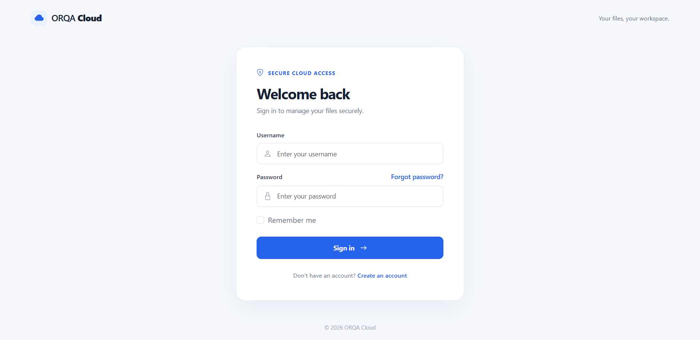
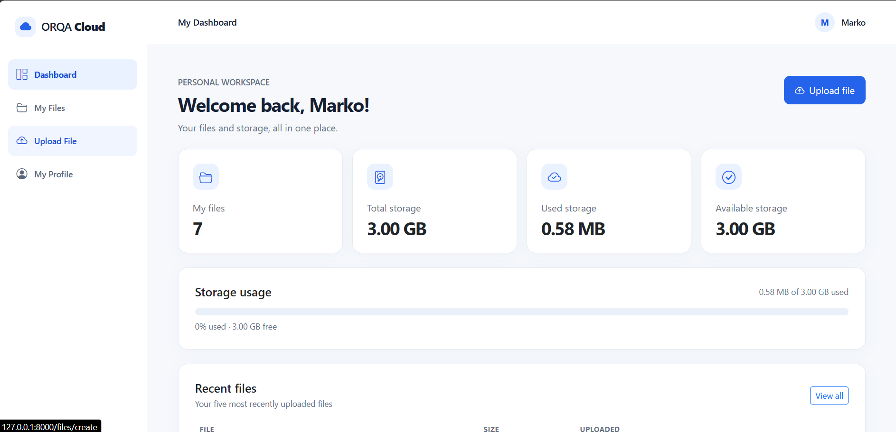
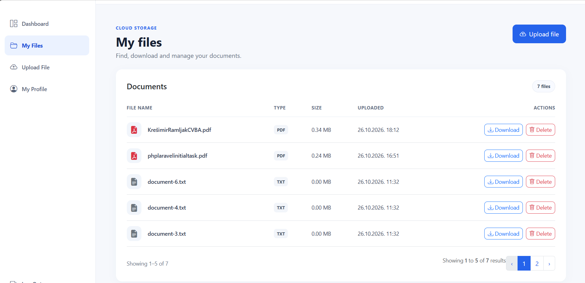
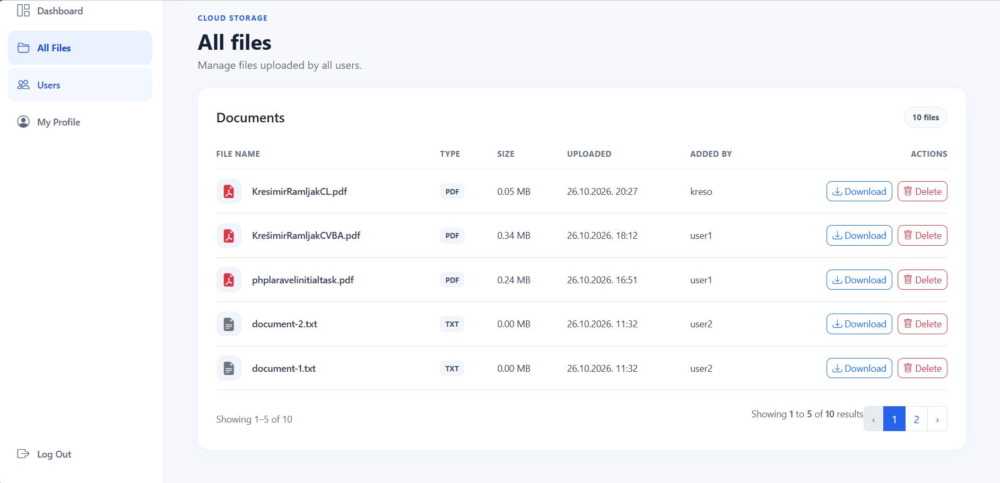
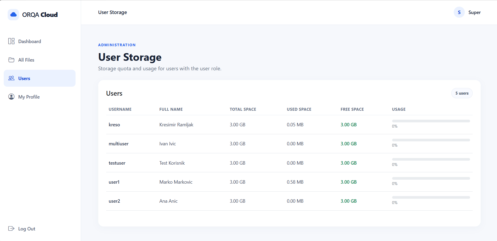
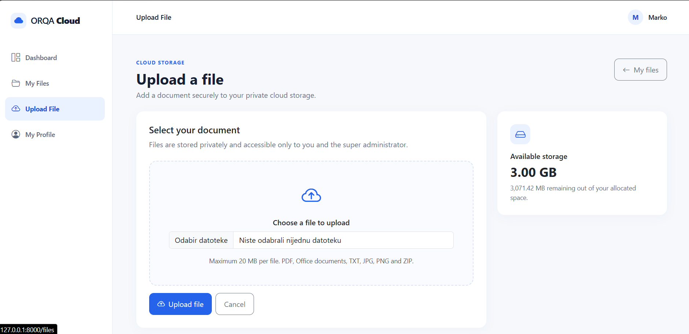

# ORQA Cloud

A Laravel 11 cloud storage web application developed as a technical assignment for the **Junior PHP Developer** position at ORQA.

ORQA Cloud allows users to securely upload, download, and delete their own files within an individual storage quota. Super administrators can manage files uploaded by all users and monitor user storage usage.

The application uses Laravel, Blade templates, and Bootstrap 5, with role-based authorization and private file storage.

## Features

- Username and password authentication
- User registration and profile management
- Support for multiple user roles
- Private file uploads, downloads, and deletion
- Individual storage quota of 3 GB per user
- Maximum upload size of 20 MB per file
- Storage usage and available space indicators
- File listings with five files per page
- File icons based on document extensions
- Super administrator overview of all uploaded files
- Super administrator overview of users and their storage usage
- Database migrations, model factories, and seeders
- Automated feature tests

## Technology Stack

| Component      | Technology                                      |
| -------------- | ----------------------------------------------- |
| Backend        | PHP 8.2+, Laravel 11                            |
| Database       | MySQL (MariaDB supported for local development) |
| Authentication | Laravel Breeze, customized for username login   |
| Frontend       | Blade, Bootstrap 5, Bootstrap Icons             |
| Asset bundling | Vite                                            |
| File storage   | Laravel Storage, private local disk             |
| Testing        | PHPUnit, SQLite in-memory                       |
| CI             | GitHub Actions                                  |

## User Roles and Permissions

The application supports multiple roles per user.

| Capability                           | Super Administrator | User |
| ------------------------------------ | ------------------- | ---- |
| View all uploaded files              | Yes                 | No   |
| Download and delete any user's files | Yes                 | No   |
| View users and their storage usage   | Yes                 | No   |
| Upload files                         | No                  | Yes  |
| View, download and delete own files  | -                   | Yes  |
| View personal storage information    | —                   | Yes  |
| Update own profile                   | Yes                 | Yes  |

### Super Administrator (`super_admin`)

Can view, download, and delete files uploaded by all users. File listings include an **Added By** column identifying the owner. The super administrator can also view users with the `user` role and their allocated, used, and remaining storage space.

### User (`user`)

Can upload supported files, manage their own files, update profile information, and monitor personal storage usage. Each user has a default storage quota of 3 GB.

### Administrator (`admin`)

The `admin` role is reserved for future use. The assignment mentions administrators as an example of possible roles but does not define separate administrator permissions.

Consequently, no standalone administrator functionality has been implemented. Assigning or changing roles through the user interface is also outside the assignment scope.

A user may have multiple roles. The demo account `multiuser` has both `user` and `admin` roles and can access the regular user functionality.

## Requirements

Before installing the application, ensure the following are available:

- PHP 8.2 or newer, with the extensions required by Laravel, including PDO MySQL, Mbstring, OpenSSL, XML, Ctype, Fileinfo, and Tokenizer
- SQLite PHP extension for automated tests
- Composer
- Node.js and npm
- MySQL or MariaDB
- Git

XAMPP can be used to provide PHP and MariaDB for local development.

For file uploads of up to 20 MB, configure the PHP environment with appropriate limits:

```ini
upload_max_filesize = 20M
post_max_size = 25M
```

Restart Apache or the relevant PHP service after changing PHP settings. If using the PHP development server, ensure the active CLI PHP configuration also has the required limits.

## Local Installation

### 1. Clone the repository

```bash
git clone https://github.com/ramljakkresimir/orqa-cloud-app.git
cd orqa-cloud-app
```

### 2. Install dependencies

```bash
composer install
npm install
npm run build
```

The frontend build is required to display the application correctly when not running the Vite development server.

### 3. Create the environment file

Copy `.env.example` to `.env`.

For Windows PowerShell:

```powershell
Copy-Item .env.example .env
```

For Linux, macOS, or Git Bash:

```bash
cp .env.example .env
```

### 4. Configure the database

Create an empty MySQL or MariaDB database named `orqa_cloud`, using your preferred database management tool.

For example:

```sql
CREATE DATABASE orqa_cloud
CHARACTER SET utf8mb4
COLLATE utf8mb4_unicode_ci;
```

Update the corresponding settings in `.env`:

```dotenv
APP_NAME="ORQA Cloud"
APP_ENV=local
APP_DEBUG=true
APP_URL=http://127.0.0.1:8000

DB_CONNECTION=mysql
DB_HOST=127.0.0.1
DB_PORT=3306
DB_DATABASE=orqa_cloud
DB_USERNAME=root
DB_PASSWORD=
```

Replace the database username and password with the credentials configured in your local environment.

The default XAMPP MariaDB installation may use `root` with an empty password, but this should not be assumed for other environments.

**Important:** Keep `APP_ENV=local` when installing the demonstration data. Demo seeding is intentionally restricted to local and testing environments.

### 5. Generate the application key

```bash
php artisan key:generate
```

### 6. Run migrations and seed demo data

```bash
php artisan migrate --seed
```

This creates the database tables, application roles, demo accounts, and example files.

The application uses database-backed sessions and cache, so the migrations must complete successfully before signing in.

### 7. Start the application

```bash
php artisan serve
```

Open:

**[http://127.0.0.1:8000](http://127.0.0.1:8000)**

The frontend assets have already been compiled with `npm run build`, so a separate Vite server is not required.

For frontend development, `npm run dev` can be used instead.

## Demo Accounts

The following accounts are created by `DemoDataSeeder` when seeding in a local or testing environment.

| Username     | Password       | Roles           |
| ------------ | -------------- | --------------- |
| `superadmin` | `Password123!` | `super_admin`   |
| `user1`      | `Password123!` | `user`          |
| `user2`      | `Password123!` | `user`          |
| `multiuser`  | `Password123!` | `user`, `admin` |

These credentials are intended exclusively for local demonstration and testing.

### Preloaded Demo Files

The demo seeder creates:

- **user1:** 6 text files, demonstrating pagination across two pages
- **user2:** 2 text files
- **superadmin:** access to all demo files through the super administrator interface
- **multiuser:** an example account with multiple roles

Demo files are written to the private `cloud` storage disk and recorded in the database. They can be downloaded and deleted through the application's normal file management interface.

Additional files may be uploaded manually to test storage quotas, file icons, and supported document types.

## File Storage

Uploaded files are stored on a dedicated Laravel disk named `cloud`.

The disk is configured in `config/filesystems.php`:

```php
'cloud' => [
    'driver' => 'local',
    'root' => storage_path('app/private/cloud'),
    'visibility' => 'private',
    'throw' => true,
],
```

The storage directory is:

```text
storage/app/private/cloud/
```

Files are organized by user:

```text
storage/app/private/cloud/users/{user_id}/
```

The database stores file metadata, including the original filename, storage path, file type, size, and owner.

Files are not exposed through a public storage URL. Downloads are handled through application routes with authorization checks.

**Do not run `php artisan storage:link` for the private cloud files.** A public storage symlink is not required for this application.

### Upload Restrictions

The application enforces:

- Maximum file size: 20 MB
- Per-user storage quota: 3 GB by default
- Allowed extensions: PDF, TXT, DOC, DOCX, XLS, XLSX, PPT, PPTX, JPG, JPEG, PNG, and ZIP
- File type and extension validation
- Server-side storage quota verification
- Role-based and ownership-based authorization

## Running Tests

The application includes 69 test methods covering authentication, registration, roles, profile management, dashboards, and file operations.

Run the complete test suite:

```bash
php artisan test
```

Tests are configured to use SQLite in-memory through `phpunit.xml`:

```dotenv
DB_CONNECTION=sqlite
DB_DATABASE=:memory:
```

The base test class includes safeguards against accidentally running tests using the development MySQL database. It also rejects cached Laravel configuration before test execution.

The tests call `$this->withoutVite()`, so a frontend build is not required specifically for running the test suite.

If Laravel configuration has been cached, clear it before testing:

```bash
php artisan config:clear
```

The tests require PHP SQLite support.

## Continuous Integration

The project uses GitHub Actions for automated testing.

On every push to the `main` branch and on pull requests, GitHub Actions installs the required dependencies, prepares the testing environment, and runs the automated test suite on PHP 8.2 and PHP 8.3.

The workflow configuration is located in `.github/workflows/tests.yml`.

Test results and workflow execution history are available in the repository's [Actions tab](https://github.com/ramljakkresimir/orqa-cloud-app/actions).

## Security and Configuration Notes

The project includes several application-level security measures:

- Authentication through Laravel Breeze
- Role-based route restrictions using custom middleware
- File ownership checks through Laravel policies
- Private storage outside the publicly accessible web directory
- Server-side file type, extension, size, and quota validation
- Generated storage filenames
- Validation of private cloud storage paths during downloads and deletion
- Database transaction handling for file operations
- Protection against using the development database during automated tests

These measures do not constitute a complete production security assessment.

### Laravel Version

Laravel 11 is used intentionally because it is explicitly required by the original technical assignment.

Laravel 11 has reached the end of its security support period. This project is therefore intended for **local demonstration and technical evaluation**, not public production deployment without further security review, dependency assessment, and framework upgrades.

Known vulnerabilities should not be considered resolved unless the affected dependencies or application code have actually been remediated.

### Environment Security

- Never commit a real `.env` file or application secrets.
- Keep `APP_DEBUG=true` restricted to local development.
- Use appropriate database credentials rather than development defaults in any deployed environment.
- Do not expose the private file storage directory publicly.
- Do not use demo credentials in a public deployment.
- Demo data is restricted to local and testing environments.

### Password Reset

Laravel's mail configuration defaults to the `log` mailer for local development. Password reset emails can therefore be written to application logs instead of being delivered through an external email service.

A production email provider is not configured as part of this assignment.

## Screenshots

### Login Page


### User Dashboard


### User File Management


### Super Administrator — All Files


### Super Administrator — User Storage


### File Upload


## Assignment Scope

This application was developed to demonstrate practical Laravel development skills, including database design, authentication, authorization, file management, Blade views, database seeding, and automated testing.

Additional administrator functionality, a role-management interface, and production hosting infrastructure are outside the defined scope of the assignment.

## Repository

[ORQA Cloud — GitHub Repository](https://github.com/ramljakkresimir/orqa-cloud-app)

Developed as a technical assignment for ORQA.
